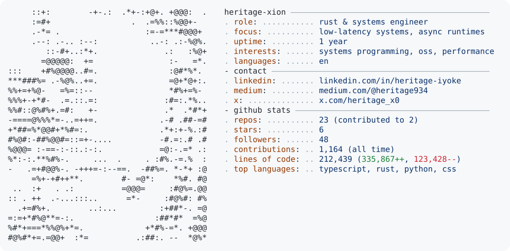

<div align="center">

<pre align="center">
██╗  ██╗███████╗██████╗ ██╗████████╗ █████╗  ██████╗ ███████╗
██║  ██║██╔════╝██╔══██╗██║╚══██╔══╝██╔══██╗██╔════╝ ██╔════╝
███████║█████╗  ██████╔╝██║   ██║   ███████║██║  ███╗█████╗  
██╔══██║██╔══╝  ██╔══██╗██║   ██║   ██╔══██║██║   ██║██╔══╝  
██║  ██║███████╗██║  ██║██║   ██║   ██║  ██║╚██████╔╝███████╗
╚═╝  ╚═╝╚══════╝╚═╝  ╚═╝╚═╝   ╚═╝   ╚═╝  ╚═╝ ╚═════╝ ╚══════╝
</pre>

[](https://git.io/typing-svg)

<p align="center">
  Systems engineer focused on low-level architecture, high-throughput concurrent runtimes, and distributed infrastructure.<br/>
  Building robust, zero-cost abstractions with <b>Rust</b>, <b>Go</b>, and Linux systems primitives.
</p>

<p align="center">
  <a href="https://linkedin.com/in/heritage-iyoke">LinkedIn</a> &nbsp;&bull;&nbsp;
  <a href="https://x.com/heritage_x0">X (Twitter)</a> &nbsp;&bull;&nbsp;
  <a href="https://github.com/Heritage-XioN">GitHub</a> &nbsp;&bull;&nbsp;
  <a href="https://medium.com/@heritage934">Medium</a> &nbsp;&bull;&nbsp;
  <a href="https://ko-fi.com/heritage33377">Ko-Fi</a>
</p>

</div>

<br/>

<div align="center">
  <picture>
    <source media="(prefers-color-scheme: dark)" srcset="https://raw.githubusercontent.com/Heritage-XioN/Heritage-XioN/output/dark_mode.svg" />
    <source media="(prefers-color-scheme: light)" srcset="https://raw.githubusercontent.com/Heritage-XioN/Heritage-XioN/output/light_mode.svg" />
    
  </picture>
</div>

<br/>

<div align="center">
  <a href="https://skillicons.dev">
    
  </a>
</div>

<br/>

<div align="center">
  <picture>
    <source media="(prefers-color-scheme: dark)" srcset="https://raw.githubusercontent.com/Heritage-XioN/Heritage-XioN/output/github-snake-dark.svg" />
    <source media="(prefers-color-scheme: light)" srcset="https://raw.githubusercontent.com/Heritage-XioN/Heritage-XioN/output/github-snake.svg" />
    
  </picture>
</div>

<br/>

<!-- ═══════════════════════════════════════════════════════════════ -->

<div align="center">

```
⣿⣿⣿⣿⣿⣿⣿⣿⣿⣿⣿⣿⣿⣿⣿⣿⣿⣿⣿⣿⣿⣿⣿⣿⣿⣿⣿⣿⣿⣿
⣿⣿⣿⣿⣿⣿⣿⣿⣿⠿⠟⠛⠉⠉⠉⠉⠛⠻⢿⣿⣿⣿⣿⣿⣿⣿⣿⣿⣿⣿
⣿⣿⣿⣿⣿⣿⡿⠋⠁⠀⠀ "Any sufficiently   ⠀⠀⠈⠙⢿⣿⣿⣿⣿⣿⣿
⣿⣿⣿⣿⣿⡟⠁⠀⠀ advanced technology is  ⠀⠀⠈⢻⣿⣿⣿⣿⣿
⣿⣿⣿⣿⡟⠀⠀⠀ indistinguishable from    ⠀⠀⠀⢻⣿⣿⣿⣿
⣿⣿⣿⣿⡇⠀⠀⠀⠀ magic." — Arthur C. Clarke ⠀⠀⠀⠀⢸⣿⣿⣿⣿
⣿⣿⣿⣿⣿⡄⠀⠀⠀⠀⠀⠀⠀⠀⠀⠀⠀⠀⠀⠀⠀⠀⠀⠀⠀⠀⠀⠀⢀⣼⣿⣿⣿⣿
⣿⣿⣿⣿⣿⣿⣦⡀⠀⠀⠀⠀⠀⠀⠀⠀⠀⠀⠀⠀⠀⠀⠀⠀⠀⠀⢀⣴⣿⣿⣿⣿⣿⣿
⣿⣿⣿⣿⣿⣿⣿⣿⣶⣤⣀⠀⠀⠀⠀⠀⠀⠀⠀⠀⠀⠀⣀⣤⣶⣿⣿⣿⣿⣿⣿⣿⣿⣿
⣿⣿⣿⣿⣿⣿⣿⣿⣿⣿⣿⣿⣶⣤⣤⣤⣤⣤⣤⣶⣿⣿⣿⣿⣿⣿⣿⣿⣿⣿⣿⣿⣿⣿
```

</div>
